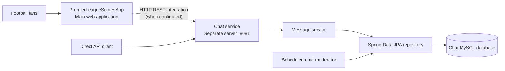

<div align="center">

# 💬 Premier League Scores App — Chat Service

### A standalone Spring Boot REST backend for fan conversations

**The companion chat service for [PremierLeagueScoresApp](https://github.com/RosenTodorov2006/PremierLeagueScoresApp), designed to run on a separate server.**


</div>

---

## Overview

**PremierLeagueScoresApp-Chat** is a small, independent Java backend built to support conversations between football fans using the main Premier League web application.

Rather than hosting every responsibility in one process, the chat functionality was separated into its **own Spring Boot application**, with its **own MySQL database** and the ability to run on a **second server**. This repository focuses on the message API, data persistence, and scheduled moderation/cleanup tasks; it does not contain the main website's UI.

> **Companion application:** [RosenTodorov2006/PremierLeagueScoresApp](https://github.com/RosenTodorov2006/PremierLeagueScoresApp) — the main Spring Boot website with scores, standings, club pages, and user-facing features.

## Why a Separate Service?

The project was created to isolate chat-related responsibilities from the main football website:

- **Independent deployment:** the chat API can run as a separate Spring Boot application on another server.
- **Separation of concerns:** score retrieval and the website UI remain distinct from message storage and chat maintenance.
- **Dedicated persistence:** chat messages are stored in the chat service's MySQL database.
- **Independent maintenance:** chat-specific scheduled jobs can run without being added to the football-data workflow.
- **REST integration boundary:** the main application or another trusted client can communicate with the chat API over HTTP when that integration is configured.

This is an architectural separation, **not** a claim that the service currently implements WebSockets, push messaging, service discovery, or production-ready microservice security.

## Technology Stack

| Layer | Technology |
| --- | --- |
| Language | Java 17 |
| Framework | Spring Boot 3.3.2 |
| HTTP layer | Spring Web / REST controllers |
| Persistence | Spring Data JPA, Hibernate, MySQL |
| Validation definitions | Jakarta Bean Validation |
| Mapping | ModelMapper 3.2.0 |
| Background work | Spring Scheduling (`@Scheduled`) |
| Build | Gradle, Gradle Wrapper |
| Testing | JUnit 5, Spring Boot Test, Mockito, MockMvc |

## Architecture



**Deployment concept:** the two Java applications can be hosted independently. The chat service listens on port **8081** in the checked-in configuration, while MySQL stores its messages.

**Integration note:** the current main application repository contains an HTTP client configuration for `http://localhost:8081`, but also has its own local chat controller/service. Consequently, merely starting this service does not prove that every chat request in the current main application is routed here. To use the two-server arrangement, configure the main application's chat calls to target this service's accessible address and verify the complete request flow.

For deployments on different machines, `localhost` refers to **each machine itself**. Replace it with the chat server's internal hostname or secured service URL in the calling application.

## Implemented Features

### 1. Message REST API

The `MessageController` exposes three endpoints under `/chat`:

- Retrieve stored messages in chronological order.
- Create a message associated with a supplied `userId`.
- Delete a message by database ID.

Messages are represented by a JPA entity with an ID, message text, sender ID, and creation timestamp.

### 2. MySQL Persistence

The application uses a `MessageRepository` extending `JpaRepository<Message, Long>` for CRUD operations. The configured database is `liveScoresAppChat`, and Hibernate is set to `ddl-auto: update` in the current development configuration.

### 3. Scheduled Chat History Cleanup

`ChatModerator.cleanChat()` runs with:

```java
@Scheduled(cron = "0 0 0/12 * * ?")
```

This deletes **all stored messages at 00:00 and 12:00 according to the server's configured time zone**. It is **not** a per-message 12-hour retention period, and it is not the 24-hour interval mentioned in an older version of this README.

### 4. Scheduled Forbidden-Word Check

`ChatModerator.checkForForbiddenWords()` is configured with:

```java
@Scheduled(fixedRate = 78000)
```

Approximately every **78 seconds**, the job inspects stored messages and deletes those whose **entire text**, converted to uppercase, exactly matches an entry in the `ForbiddenWords` enum.

**Important limitation:** this is a periodic exact-message comparison; it does **not** reject messages immediately when submitted, detect forbidden words embedded in longer sentences, or provide comprehensive content moderation.

### 5. Service and Controller Tests

The repository includes tests for message retrieval, scheduled cleanup/moderation, and the HTTP controller using JUnit, Mockito, Spring Boot Test, and MockMvc. The existence of these tests does not imply that a current test run has been executed or passed.

## API Reference

Default local base URL: `http://localhost:8081`

| Method | Endpoint | Description | Response |
| --- | --- | --- | --- |
| `GET` | `/chat` | Return messages sorted by creation time | `200 OK` + JSON array |
| `POST` | `/chat` | Store a new message | `200 OK` (empty body) |
| `DELETE` | `/chat/{id}` | Delete a message by ID | `204 No Content` |

### Create a Message

```http
POST /chat HTTP/1.1
Content-Type: application/json

{
  "userId": 1,
  "userMessage": "What a match from Liverpool!"
}
```

Example with `curl`:

```bash
curl -X POST http://localhost:8081/chat \
  -H "Content-Type: application/json" \
  -d '{"userId":1,"userMessage":"What a match from Liverpool!"}'
```

### Retrieve Messages

```bash
curl http://localhost:8081/chat
```

Illustrative response shape:

```json
[
  {
    "id": 1,
    "message": "What a match from Liverpool!",
    "userEmail": null,
    "created": "2026-11-05T18:30:00",
    "userId": 1
  }
]
```

The `userEmail` field exists in the export DTO, but this standalone service does not look up users' email addresses from the main application's database.

### Delete a Message

```bash
curl -X DELETE http://localhost:8081/chat/1
```

**API contract note:** `AddMessageDto` declares `@NotBlank` and a maximum length of 1,000 characters, but the current controller does **not** annotate the request body with `@Valid`. As written, automatic validation of these constraints is not assured by the endpoint.

## Project Structure

```text
PremierLeagueScoresApp-Chat/
├── build.gradle
├── settings.gradle
├── gradlew / gradlew.bat
└── src/
    ├── main/
    │   ├── java/bg/soft_uni/premierleagueappchat/
    │   │   ├── PremierLeagueAppChatApplication.java
    │   │   ├── configurations/
    │   │   │   └── ApplicationConfiguration.java
    │   │   ├── models/
    │   │   │   ├── dtos/
    │   │   │   └── entities/
    │   │   ├── repositories/
    │   │   │   └── MessageRepository.java
    │   │   ├── services/
    │   │   │   └── impl/MessageServiceImpl.java
    │   │   ├── services/scheduling/
    │   │   │   └── ChatModerator.java
    │   │   └── web/
    │   │       └── MessageController.java
    │   └── resources/application.yml
    └── test/
        ├── java/.../service/
        │   ├── MessageServiceImplTest.java
        │   └── SchedulingTest.java
        └── java/.../web/MessageControllerIT.java
```

## Getting Started

### Prerequisites

- JDK **17**
- MySQL server
- Git
- No system-wide Gradle installation is required (Gradle Wrapper is included)

### 1. Clone

```bash
git clone https://github.com/RosenTodorov2006/PremierLeagueScoresApp-Chat.git
cd PremierLeagueScoresApp-Chat
```

### 2. Prepare the Database

The checked-in configuration uses a local MySQL connection:

```text
jdbc:mysql://localhost:3306/liveScoresAppChat?allowPublicKeyRetrieval=true&useSSL=false&createDatabaseIfNotExist=true&serverTimezone=UTC
```

Create the database manually if your MySQL account cannot create databases automatically:

```sql
CREATE DATABASE liveScoresAppChat;
```

### 3. Configure Database Credentials

The current `src/main/resources/application.yml` contains directly configured database credentials. **Do not reuse these credentials for public deployments.** Prefer environment-variable placeholders, for example:

```yaml
spring:
  datasource:
    driverClassName: com.mysql.cj.jdbc.Driver
    url: jdbc:mysql://localhost:3306/liveScoresAppChat?serverTimezone=UTC
    username: ${DB_USERNAME}
    password: ${DB_PASSWORD}
  jpa:
    database-platform: org.hibernate.dialect.MySQLDialect
    hibernate:
      ddl-auto: update
    open-in-view: false
server:
  port: 8081
```

The example above is a **recommended configuration change**, not the exact checked-in file. Set `DB_USERNAME` and `DB_PASSWORD` in your shell, IDE run configuration, or deployment environment before starting the service.

For a remote database, use an appropriate private network connection and TLS configuration rather than copying a local-development JDBC URL unchanged.

### 4. Run the Service

Linux / macOS:

```bash
./gradlew bootRun
```

Windows:

```powershell
.\gradlew.bat bootRun
```

Then access:

```text
http://localhost:8081/chat
```

### 5. Build and Test

Linux / macOS:

```bash
./gradlew test
./gradlew bootJar
```

Windows:

```powershell
.\gradlew.bat test
.\gradlew.bat bootJar
```

Integration tests may require a working datasource or additional test-specific database configuration. They have not been executed as part of preparing this README.

## Operational and Security Notes

This is a **portfolio/learning project**, not a hardened public chat platform. Before exposing it to untrusted traffic, consider these implementation details:

- **No enforced API authentication or authorization:** the main runtime dependencies and controller do not implement an access-control layer. In particular, client-supplied `userId` values should not be trusted without identity verification.
- **No immediate input validation:** the DTO has constraints, but the controller does not currently use `@Valid`.
- **Moderation is delayed and exact-match only:** the scheduled filter is not a comprehensive profanity or abuse-detection system.
- **Global purge:** the scheduled cleanup removes *every* stored message twice daily, regardless of each message's age.
- **Redundant save call:** `MessageServiceImpl.addMessage` invokes `messageRepository.save(messages)` twice for the same entity; this should be simplified and covered by a test.
- **Credentials in configuration:** database credentials are directly stored in the repository. Replace them with environment variables or a secret manager; rotate any credentials that were exposed.
- **Separate-server exposure:** use authenticated service-to-service communication, HTTPS/TLS, network restrictions, request limits, and careful CORS configuration where browser access is required.
- **No WebSockets:** updates reach clients only through HTTP requests; any polling or real-time UI behavior belongs to the consuming application.

## Possible Improvements

- Connect the parent application to the service through a clearly configured REST client and dedicated service URL.
- Add identity verification and authorization for creating/deleting messages.
- Enable `@Valid` request validation and structured error responses.
- Check content before persistence and use more robust moderation rules.
- Replace global cleanup with a configurable age-based retention policy if desired.
- Add pagination to `GET /chat` and indexes for message timestamps.
- Add unit and integration coverage for both valid and invalid requests.
- Add deployment configuration, health checks, and CI if independent hosting is continued.

## Related Repository

**Main application:** [PremierLeagueScoresApp](https://github.com/RosenTodorov2006/PremierLeagueScoresApp)

The main application provides the broader football website, while this repository demonstrates an approach for **separating chat infrastructure into another Spring Boot service and server**.

## Author

Developed by **[Rosen Todorov](https://github.com/RosenTodorov2006)**.

---

*Documentation is based on the checked-in `master` branch. Features and limitations are described as implemented; separate-server deployment describes the intended architecture rather than an independently verified production installation.*
